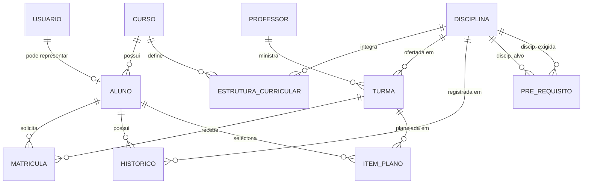
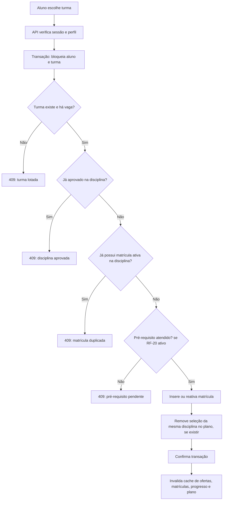

# Arquitetura e plano de execução — Sistema de Matrícula

**Status:** versão 2.0 — proposta técnica com RF-20 e RF-21, não implementação.  
**Dependência:** ler `01-REQUISITOS.md`, sobretudo a distinção entre [E] (edital), [D] (decisão) e [A] (hipótese).

## 1. Critérios para escolher a solução

1. Cobrir integralmente a regra de negócio de matrícula e progresso antes de investir em acabamento visual.
2. Isolar decisões de domínio de HTTP, banco e componentes React, porque a entrevista poderá pedir mudanças de comportamento.
3. Preferir poucas dependências conhecidas; implementação legível e fácil de executar localmente.
4. Priorizar teste de regra pura e integração com persistência; uma tela bonita não compensa cálculo errado ou excesso de vagas.
5. Registrar **por que** a decisão foi tomada e seu custo; não apresentar preferências técnicas como exigência do enunciado.

## 2. Stack recomendada [D]

| Camada | Escolha proposta | Justificativa / custo |
|---|---|---|
| Front-end | React + TypeScript + Vite | Atende React e simplifica SPA; TS ajuda nos contratos e enumerações. |
| Rotas web | React Router | `/login`, `/aluno/...`, `/secretaria/...`, e query params. |
| Dados remotos | TanStack Query | Loading, erro, retry controlado e invalidação após matrícula/cancelamento. |
| Formulários | React Hook Form + Zod (opcional) | Validação e ergonomia, sem substituir validação server-side. |
| Back-end | Fastify + TypeScript | Rotas declarativas, schema/validação, tipagem; alternativa Express válida. |
| Banco | PostgreSQL em Docker Compose | Unicidade, transações, bloqueio de linhas para vagas concorrentes. |
| ORM | Prisma | Migrações, seed, consultas tipadas; usar SQL em transações onde necessário. |
| Testes | Vitest (domínio e integração), React Testing Library (UI), Playwright (fluxos críticos) | Pirâmide enxuta e verificações reais. |
| Empacotamento | npm workspaces ou pnpm workspaces | Monorepo simples; **escolher apenas um gerenciador**. |

**Trade-off:** Docker/PostgreSQL acrescentam um serviço local, mas simplificam a explicação de consistência concorrente. Se ambiente ou tempo impedirem, SQLite é alternativa viável, desde que a estratégia atômica de vagas seja revisada e testada adequadamente.

## 3. Estrutura do repositório

```text
sistema-matricula/
├── apps/
│   ├── api/
│   │   ├── prisma/
│   │   │   ├── schema.prisma
│   │   │   ├── migrations/
│   │   │   └── seed.ts
│   │   ├── src/
│   │   │   ├── modules/
│   │   │   │   ├── auth/
│   │   │   │   ├── disciplinas/
│   │   │   │   ├── professores/
│   │   │   │   ├── turmas/
│   │   │   │   ├── matriculas/
│   │   │   │   ├── prerequisitos/
│   │   │   │   ├── planejamento/
│   │   │   │   └── progresso/
│   │   │   ├── common/          # erros de domínio, auth, validadores
│   │   │   ├── app.ts
│   │   │   └── server.ts
│   │   └── tests/
│   └── web/
│       ├── src/
│       │   ├── app/             # rotas/layouts e auth boundary
│       │   ├── features/
│       │   │   ├── autenticacao/
│       │   │   ├── secretaria/
│       │   │   └── aluno/
│       │   ├── components/      # UI reutilizável enxuta
│       │   ├── lib/             # cliente HTTP, query params
│       │   └── main.tsx
│       └── tests/
├── docs/
│   ├── 01-REQUISITOS.md
│   ├── 02-ARQUITETURA-E-EXECUCAO.md
│   ├── 03-PLANO-DE-TESTES.md
│   └── 04-FUNCIONALIDADES-DIFERENCIAIS.md
├── docker-compose.yml
├── .env.example
├── package.json
└── README.md
```

### Fronteiras entre responsabilidades

- **Rotas/controladores:** ler entradas e usuário autenticado; chamar serviço; enviar status HTTP; **não** calcular progresso nem vagas.
- **Serviços de aplicação:** coordenar transações, autorização contextual e chamadas ao domínio.
- **Domínio:** funções puras `classificarDisciplina`, `calcularProgresso`, validações de regra que não dependam de framework.
- **Persistência:** Prisma/consultas e transações; garantir uniqueness/foreign keys/checks no banco, além das validações no servidor.
- **Front-end:** interações, apresentação e estados; **não** constitui autoridade sobre capacidade de vagas nem sobre aprovação.

## 4. Modelo de dados proposto



| Entidade | Campos essenciais | Restrições |
|---|---|---|
| `usuarios` | id, username, passwordHash, perfil (`SECRETARIA`,`ALUNO`), alunoId? | username único; aluno vinculado para perfil ALUNO. |
| `cursos` | id, nome, chObrigatoria, chPerfil, chLivre | Requisitos CH >= 0; dados por seed. |
| `alunos` | id, nome, cursoId | Pertence a exatamente 1 curso. |
| `disciplinas` | id, codigo, nome, ch | codigo único; CH 15..120 e múltipla de 15. |
| `estruturas_curriculares` | cursoId, disciplinaId, tipo (`OBRIGATORIA`,`PERFIL`) | par (cursoId, disciplinaId) único. Ausência = LIVRE. |
| `professores` | id, nome, email | email único. |
| `turmas` | id, disciplinaId, professorId, vagasTotais | vagasTotais inteiro >=1. |
| `matriculas` | id, alunoId, turmaId, situacao (`ATIVA`,`CANCELADA`), criadoEm, canceladoEm? | par (alunoId,turmaId) único [D]; cancelar muda situação. |
| `historicos` | id, alunoId, disciplinaId, situacao (`APROVADO`,`REPROVADO`) | Pode haver diferentes tentativas; não modelar entidade semestre. |
| `pre_requisitos` | disciplinaId, disciplinaExigidaId | RF-20; par único, sem auto-referência e com checagem de ciclos no seed [D]. |
| `itens_plano` | id, alunoId, turmaId, criadoEm | RF-21; (`alunoId`,`turmaId`) único; validação transacional impede duas turmas da mesma disciplina no plano [D]. |

**Nota:** não persistir `elegivel`, `projecao`, `CH planejada` nem `vagasDisponiveis` como fatos definitivos; computar na consulta usando histórico, estrutura, matrículas, plano e capacidade atual. Também não persistir os mínimos curriculares por turma.

**Controle de duplicidades:** `itens_plano` referencia uma turma e o aluno. A unicidade por *disciplina* escolhida (mesmo se forem turmas distintas) é validada sob lock do aluno no serviço: não confiar apenas na unique de (`alunoId`,`turmaId`).

**Vagas:** não persistir `vagasDisponiveis` como fonte independente. Calculá-la por `vagasTotais - COUNT(matriculas ATIVAS)`. O controle transacional protege a invariante no momento de cadastrar/cancelar/altera vagas.

## 5. Contratos de API (proposta)

**Prefixo:** `/api` — JSON com data estruturada; sessão via cookie HttpOnly.

| Método | Rota | Acesso | Função |
|---|---|---|---|
| POST | `/api/auth/login` | público | Recebe `{username,password}`; abre sessão. |
| GET | `/api/auth/me` | autenticado | Retorna id, perfil e dados necessários à navegação. |
| POST | `/api/auth/logout` | autenticado | Limpa sessão. |
| GET | `/api/disciplinas?q=&page=&limit=` | secretaria | Busca paginada. |
| POST | `/api/disciplinas` | secretaria | Criação validada. |
| PATCH | `/api/disciplinas/:id` | secretaria | Edição validada. |
| GET | `/api/professores` | secretaria | Listagem. |
| POST | `/api/professores` | secretaria | Cadastro. |
| GET | `/api/turmas` | secretaria | Lista turma/ocupadas/totais. |
| POST | `/api/turmas` | secretaria | Abertura de turma. |
| PATCH | `/api/turmas/:id/vagas` | secretaria | Ajuste de capacidade. |
| GET | `/api/aluno/ofertas?q=&page=&limit=` | aluno | Lista turmas, categoria curricular, disponíveis e ações. |
| GET | `/api/aluno/matriculas` | aluno | Apenas matrículas ativas do usuário autenticado. |
| POST | `/api/aluno/matriculas` | aluno | `{turmaId}`; valida e efetiva. |
| DELETE | `/api/aluno/matriculas/:id` | aluno | Cancelamento lógico da própria matrícula. |
| GET | `/api/aluno/progresso` | aluno | Retorna apenas o progresso **real**: aprovações e CH em curso. |
| GET | `/api/aluno/plano` | aluno | Itens persistidos + impedimentos atuais + resumo da simulação. |
| POST | `/api/aluno/plano/itens` | aluno | `{turmaId}`; adiciona seleção sem criar matrícula nem reservar vagas. |
| DELETE | `/api/aluno/plano/itens/:id` | aluno | Remove apenas item próprio (não cancela matrícula). |
| DELETE | `/api/aluno/plano` | aluno | Limpa seleções do aluno autenticado. |

**Resposta de paginação** [D]:

```json
{
  "items": [],
  "pagination": { "page": 1, "limit": 10, "total": 0, "totalPages": 0 }
}
```

**Erro unificado** [D]:

```json
{
  "error": {
    "code": "TURMA_LOTADA",
    "message": "Esta turma não possui vagas disponíveis.",
    "details": {}
  }
}
```

Use, de forma coerente: `400/422` dados inválidos; `401` não autenticado/sessão expirada; `403` perfil sem permissão; `404` recurso inexistente ou matrícula/item de plano de outro aluno sem revelar propriedade; `409` conflito de regra (lotação, já aprovado, duplicidade, capacidade insuficiente, pré-requisito pendente, item de plano duplicado); `201` criado, `200` consulta/alteração, `204` cancelamento ou remoção.

O `GET /api/aluno/plano` deve devolver `itens` com `impedimentos[]` estruturados (ex.: `PRE_REQUISITO_PENDENTE`, `TURMA_LOTADA`) e `simulacao.grupos` com métricas `integralizada`, `emCurso`, `planejadaElegivel`, `projetada`, `faltanteProjetada`, `percentualProjetado`. Itens impedidos aparecem separadamente e não alimentam `planejadaElegivel`. O `POST /api/aluno/matriculas` **permanece o único caminho** de efetivação. Ver contrato detalhado em `04-FUNCIONALIDADES-DIFERENCIAIS.md`.

### Sem vazamento entre perfis

O back-end identifica aluno pelo usuário autenticado e **nunca aceita `alunoId` informado pelo front** em matrícula, cancelamento, listagem de matrículas, progresso **ou plano de matrícula**. A proteção visual das rotas não substitui middleware de autorização no back-end.

## 6. Fluxos críticos e consistência

### Fluxo 1 — Matrícula



**Concorrência:** executar checagem de ocupação e criação **na mesma transação** com lock de linha da turma (`SELECT ... FOR UPDATE`, PostgreSQL). Para evitar inscrições simultâneas do mesmo aluno em turmas diferentes da mesma disciplina, bloquear primeiro a linha do aluno e depois a turma, sempre nesta ordem nas rotas de matrícula e cancelamento. A redução de vagas bloqueia a turma. Essa estratégia deve ser coberta por teste de integração com duas requisições paralelas.

### Fluxo 1b — Planejamento e simulação (RF-21, não efetiva matrícula)

1. Autorizar aluno pelo contexto da sessão. A seleção só contém `alunoId` e `turmaId` persistidos; adicionar/remover nunca mexe na tabela de matrículas.
2. `POST /plano/itens`: rejeitar disciplina aprovada, já matriculada ou já selecionada em outra turma; **não** rejeitar apenas por lotação/pré-requisito (são opções exploratórias com alerta).
3. `GET /plano`: buscar itens e calcular os impedimentos **atuais** de cada oferta. Marcar como `ELEGIVEL` somente quando sem impedimento.
4. Reutilizar o serviço de progresso para calcular `aprovado`, `em curso` e `planejado elegível` por categoria do curso; calcular projeção sob hipótese de aprovação futura, alocando excedentes de perfil na sequência aprovada→ativa→planejada.
5. Manter `GET /progresso` inalterado. A projeção é **adicional**; porcentagens de conclusão real não são substituídas pelas simuladas.
6. Ao escolher **Matricular-se** no planejamento, enviar `POST /aluno/matriculas`, com a mesma validação transacional da tela de ofertas. Em sucesso, remover seleção correspondente na mesma transação; em erro, mantê-la e exibir causa.
7. Limpar, remover ou atualizar plano invalida apenas consultas pertinentes; somente matrícula efetiva altera ocupação, progresso `em curso` e disponibilidade.

**Sem matrícula em lote no MVP.** Isso evita prometer atomicidade entre várias turmas quando uma vaga pode desaparecer; matrícula individual é explícita e revalidada.

### Fluxo 2 — Cancelamento

1. Sessão e papel ALUNO validados.
2. Resolver matrícula por identificador; autorizar somente se `matricula.alunoId === alunoAutenticado.id` e `situacao === ATIVA`.
3. Dentro da transação (locks na ordem acordada), marcar `CANCELADA` e `canceladoEm`.
4. Ocupação passa a considerar uma matrícula ativa a menos, sem apagar histórico de operação.
5. Front-end invalida ofertas, matrículas ativas e progresso.

### Fluxo 3 — Progresso

1. Carregar curso e metas CH do aluno.
2. Carregar estrutura curricular do curso.
3. Carregar disciplinas `APROVADO` do histórico e matrículas `ATIVA` atuais.
4. Classificar cada disciplina por **curso**, não por atributo global.
5. Somar aprovações uma vez por disciplina, separando O/P/L.
6. Aplicar excedente **de perfil aprovado** a livre, e distribuir carga **em curso** separadamente.
7. Calcular faltas e percentuais com clamp; devolver os três grupos com exigida/integralizada/emCurso/faltante/percentual.
8. Exibir explícito na interface que `em curso` **ainda não é CH integralizada**.

## 7. Dados iniciais (seed planejado)

Para permitir demonstração independente do cadastro da secretaria:

**Cursos:**

- SI — Sistemas de Informação: exigências `obrigatórias=120h`, `perfil=60h`, `livres=90h`.
- EC — Engenharia da Computação: mesmas metas para simplificar comparação; curricular diferente.

**Disciplinas (todas 60h):**

| Código | Disciplina | SI | EC |
|---|---|---|---|
| IF101 | Algoritmos | Obrigatória | Perfil |
| IF102 | Estruturas de Dados | Obrigatória | Obrigatória |
| IF103 | Projeto de Software | Perfil | Livre (não consta) |
| IF104 | Interfaces Digitais | Perfil | Livre (não consta) |
| IF105 | Eletrônica Digital | Livre (não consta) | Obrigatória |
| IF106 | Sistemas Embarcados | Livre (não consta) | Perfil |

**Contas de demonstração (credenciais somente de desenvolvimento):** secretaria + `ana.si` + `bruno.ec` + `carla.ec`. Os nomes são fictícios. Utilizar senhas de teste documentadas no README e hash no banco, jamais credenciais de produção.

**Históricos:**
- Ana (SI): aprovada IF101, IF103 e IF104; reprovada IF102. Portanto: obrigatório 60h, perfil 60h, livre 60h **de excesso de perfil**, faltam 60h/0h/30h.
- Bruno (EC): aprovado IF102 e IF101; reprovado IF105. Portanto: obrigatório 60h, perfil 60h, livre 0h; faltam 60h/0h/90h. IF105 pode ser repetida.
- Carla (EC): aprovada IF102 e reprovada IF101; pode ser usada para ocupar uma turma de capacidade 1 e testar lotação.

**Ofertas:** ao menos uma turma para IF102, IF105 e IF106, com professores e capacidades distintas. Criar uma turma lotada por matrícula ativa de Carla; manter outras disponíveis para testar matrícula/cancelamento. O seed deve ser **idempotente**: executar de novo não duplica dados nem matrículas.

**Casos dos diferenciais:** cadastrar pré-requisito `IF106 ← IF102`. Ana ainda não foi aprovada em IF102 e fica bloqueada; Bruno já passou e é elegível (se houver vaga). Para demonstração do plano, manter ofertas distintas de IF102 (disponível), IF105 (ao menos uma disponível) e IF106 (ao menos uma disponível). Seleção de Ana: IF102 e IF105 elegíveis; IF106 impedida por pré-requisito. Seleção de Bruno: IF106 elegível; como EC já cumpriu 60h de perfil com IF101, CH de IF106 é excedente projetado para livre. O seed começa com planos vazios para não confundir cenários; ações são demonstradas via UI.

## 8. Interface e experiência de uso

**Rotas:**

```text
/login
/aluno/ofertas?q=...&page=1
/aluno/matriculas
/aluno/progresso
/aluno/planejamento
/secretaria/disciplinas?q=...&page=1
/secretaria/professores
/secretaria/turmas
```

**Aluno (mobile first, 360px):** cartões de turma em coluna única, código/nome/CH, professor, vagas restantes, classificação por curso e botões de matrícula **e de adicionar ao plano**; pré-requisitos cumpridos/pendentes visíveis; confirmação de cancelamento; progresso separado em três grupos com números sempre legíveis. Em `/aluno/planejamento`: lista de seleções, impedimentos e comparação explícita entre **progresso real × projeção**, com ações de remoção, limpeza e matrícula individual; sem rolagem lateral.

**Secretaria (desktop):** tabelas e formulários simples; ocupação `ocupadas / totais`; controles para editar vagas, com erro de regra visível ao usuário; buscar disciplinas e navegar páginas.

**Estados em toda listagem:** skeleton ou indicador de carregamento; estado vazio inicial (sem registros); busca sem resultado (diferente de vazio); falha de rede/API com ação "Tentar novamente"; retorno visual de sucesso; confirmação/erro de mutações.

**Query params:** inicializar filtros da URL; ao alterar busca, voltar à página 1; ao mudar página, atualizar URL; botão voltar do navegador restaura busca/página. A API usa a mesma paginação; não paginar apenas dados locais sem necessidade.

**Sincronia:** após `POST /matriculas`, atualizar/invalidate `ofertas`, `matriculas`, `progresso`, `plano`. Ao cancelar, repetir. Ao adicionar/remover itens do plano, invalidar `plano` sem alterar o progresso oficial. Mesmo que o botão esteja habilitado, o servidor pode recusar por lotação e o front-end apresenta mensagem clara.

## 9. Plano de desenvolvimento por incrementos

| Etapa | Objetivo | Entrega demonstrável | Critério para avançar | Prioridade |
|---|---|---|---|---|
| 0 — Preparação | Repo, tooling, README mínimo, .env.example, Docker e CI simples | `npm install` e banco sobem; API health | Setup reproduzível e 1 commit | P0 |
| 1 — Domínio e dados | Schema/migrations, seed, regras puras de classificação e progresso | Dois cursos, alunos e histórico consultáveis; testes de cálculo | RN-01..04/10..13 cobertas | P0 |
| 2 — Autenticação e aluno/API | Auth, guardas, listagem de ofertas, matrícula e cancelamento com transações | Fluxos críticos por HTTP funcionando | RN-06..09 e permissão testados | P0 |
| 3 — Aluno/web | Login, ofertas, matrículas, progresso e estados de UI | Navegável em 360px; URL de busca/página | Testes e2e críticos passando | P0 |
| 4 — Secretaria/API+web | CRUD de disciplinas requerido; cadastro professores; turmas e vagas | Secretaria usa tudo no desktop | RN-01..05 e validações passando | P1 |
| 5 — Extra 1: pré-requisitos | Regras, seed, validador, aviso em oferta e bloqueio em matrícula | Pendências claras no back e front | T-EXTRA-01..08 passando | P2 |
| 6 — Extra 2: planejamento | Persistência, API, página responsiva, simulação e ação de matricular individualmente | Plano não ocupa vaga nem altera progresso real | T-PLAN-01..16 passando | P3 |
| 7 — Acabamento/entrega | Testes de regressão, acessibilidade, erros, README, revisão de commits e compartilhamento | Outro desenvolvedor reproduz do zero | Checklist final completo | P0 transversal |

**Ponto de corte:** se não houver tempo para tudo, primeiro concluir e documentar etapas 0–3 + testes. Só depois entregar a secretaria. Não sacrificar o núcleo para o adicional.

## 10. Backlog enxuto com dependências

- **B01 — Ambiente:** scripts `dev`, `build`, `test`, `db:migrate`, `db:seed`; `.env.example`; compose.
- **B02 — Modelo:** tabelas, FKs, unique, checks e migração; depende B01.
- **B03 — Seed:** dois cursos, classificação compartilhada, secretaria, três alunos, histórico e turmas; depende B02.
- **B04 — Domínio de progresso:** função pura, excedente de perfil, clamp, CH em curso; depende B02/B03.
- **B05 — Autenticação/perfis:** login, sessão, rota `/me`, autenticação e guardas; depende B01/B03.
- **B06 — Ofertas/matrícula:** listar, buscar/paginar, transação e validações; depende B02/B05.
- **B07 — Cancelamento:** propriedade, mudança de estado, liberação de vaga; depende B06.
- **B08 — Progresso API:** DTO e serviço de leitura; depende B04/B05.
- **B09 — Web aluno:** login, ofertas, minhas matrículas, progresso e feedback; depende B05–08.
- **B10 — Secretaria API:** disciplinas/professores/turmas, validações e limite de vagas; depende B02/B05.
- **B11 — Secretaria web:** telas e formulários; depende B10.
- **B12 — Extra 1:** pré-requisitos, bloqueios no backend, exibição e testes; depende B06/B09.
- **B13 — Extra 2/base:** tabela `itens_plano`, migração, políticas de propriedade e API CRUD; depende B02/B05/B12.
- **B14 — Extra 2/projeção:** função pura de distribuir CH em fases aprovada→ativa→planejada elegível; depende B04/B13.
- **B15 — Extra 2/UI:** ação nas ofertas, tela 360px, alertas, simulação e matrícula individual; depende B09/B13/B14.
- **B16 — Qualidade:** testes de regressão, e2e, README e revisão; contínua, fechamento após B09/B11 e extras concluídos.

## 11. Testes — estratégia

1. **Unitários:** funções puras (classificação, cálculo do progresso e validações), rápidos e determinísticos.
2. **Integração com banco real de teste:** unicidade, persistência, status HTTP, autorização e transações sob concorrência.
3. **Componentes React:** estados loading/empty/error, comportamento dos botões e atualização de URL.
4. **E2E mínimo obrigatório:** (i) Ana entra, vê categorias, se matricula e cancela; (ii) secretaria abre turma e ajusta vagas; (iii) perfil incorreto não acessa outra área; (iv) viewport 360px. **E2E extras:** Ana adiciona IF106 impedida e IF102 elegível ao plano, vê simulação, matrícula individual não quebra a segurança nem reserva antecipadamente.

Ver `03-PLANO-DE-TESTES.md` para cenários identificados e rastreados. Não usar apenas mocks para dizer que limite de vagas sob concorrência foi validado.

## 12. Riscos e prevenção

| Risco | Impacto | Prevenção |
|---|---|---|
| Contagem concorrente permite superar vagas | Alto | transação com lock e teste paralelo. |
| Progresso transfere CH indevidamente | Alto | casos com perfil acima/abaixo da exigência e obrigatórias excedentes. |
| Autorização só no React | Alto | middleware de papel e escopo aluno no back-end. |
| Excesso de infraestrutura toma o prazo | Alto | monorepo e setup mínimos, evitar serviços externos. |
| UI esconde falhas de regras | Médio/alto | erro de domínio com código, mensagem e 409; testes de feedback. |
| Sessão expirada deixa tela incoerente | Médio | interceptação de 401 e redirecionamento. |
| Seed não reproduz testes ou duplica | Médio | upsert/ids estáveis; teste após duas execuções. |
| Extras crescem além do tempo | Alto | priorizar obrigatórios e pré-requisitos antes da simulação; limitar plano a cenário único e matrícula individual. |
| Simulação confundida com matrícula real | Alto | rótulos e DTOs separados: aprovada, em curso, planejada, projetada; plano nunca muda vagas. |
| Vaga ou pré-requisito muda depois de planejar | Alto | recálculo de impedimentos no GET e revalidação transacional na matrícula efetiva. |
| Soma duplicada de CH no planejamento | Alto | função pura que redistribui excedente de perfil por etapas; testes numéricos e snapshot imutável de histórico. |
| Duplicação de mesma disciplina em duas turmas do plano | Médio | lock por aluno ao adicionar; validação por disciplina derivada de turma. |
| Alteração de CH impacta histórico passado | Médio | documentar decisão do MVP e possível snapshot futuro. |

## 13. Commits sugeridos (histórico real, não fabricado)

```text
chore: inicializa monorepo, scripts e ambiente local
feat(db): cria modelo academico e dados iniciais
feat(auth): implementa login e autorizacao por perfil
test(progresso): cobre classificacao e excedente de perfil
feat(api): consulta ofertas e matricula transacional
feat(api): permite cancelar matricula propria
feat(web): implementa fluxo do aluno responsivo
feat(api): administra disciplinas, professores e turmas
feat(web): implementa telas da secretaria
feat(extra): valida pre-requisitos de matricula
feat(plano): persiste selecao de turmas e exibe impedimentos
feat(progresso): simula carga horaria planejada sem alterar progresso real
feat(web): adiciona planejamento de matricula responsivo
test(e2e): cobre fluxos criticos e controle de acesso
docs: finaliza readme e decisoes tecnicas
```

Fazer o commit correspondente **quando a etapa existir e funcionar**. Não criar commits artificiais ou com mensagens que afirmem um nível de conclusão falso.

## 14. README exigido e roteiro de entrega

O `README.md` final deve conter:

- Contexto e escopo do desafio; stack e razões das escolhas.
- Pré-requisitos para executar (Node, gerenciador, Docker); comandos completos de instalação, `.env`, `docker compose`, migração, seed, dev, build, testes.
- URLs de web/API, credenciais **fictícias do ambiente local**, descrições de cada papel e dos dados de teste.
- Contratos ou link OpenAPI, exemplos de requisição/resposta de erro.
- Regras de negócio e cálculos controversos, incluindo diferença de CH aprovada e em curso.
- **Dois requisitos extras**: pré-requisitos e planejamento, cada um com descrição, motivação, regras próprias, demonstração, testes e limitações. Explicar que o edital exigia somente um.
- Arquitetura, principais decisões e trade-offs (PostgreSQL, locks, session, estrutura).
- O que faria com mais tempo, e itens não implementados com motivo honesto.

**Entrega:** repositório **pessoal** do GitLab CIn, com web e API juntos, compartilhado com `selecaogersist` **antes do prazo aplicável**. Verificar acesso e rodar `install/migrate/seed/test/build` em ambiente limpo antes da entrega. O PDF do teste não explicita aqui a data-limite; conferir o edital e as comunicações da seleção, sem presumir um dia.

## 15. Preparação para a entrevista

Ser capaz de demonstrar, sem consultar resposta gerada:

1. Por que estrutura curricular é uma relação *curso–disciplina* (e não atributo de disciplina).
2. Como uma disciplina passa de perfil a livre se estiver fora do currículo, e como excedente de perfil aprovado é redistribuído.
3. Por que ativa não conta como integralizada e reprovada não conta.
4. Como uma única vaga continua única sob dois `POST` simultâneos.
5. Por que a API não aceita `alunoId` fornecido pelo cliente e como 401 difere de 403.
6. Como adicionar uma regra de matrícula sem alterar componentes React indevidamente.
7. Quais mudanças faria para suportar múltiplos semestres, histórico de turmas e CH no momento da aprovação.
8. Por que uma turma pode constar do plano mesmo sem vaga/pré-requisito e por que isso não garante matrícula.
9. Por que uma matrícula é sempre revalidada no servidor, embora a UI mostre `elegível`.
10. Por que o progresso real não se confunde com a projeção e como o excedente de perfil é distribuído sem duplicação.
11. Como executar o projeto do zero e qual teste prova cada regra essencial.

**Decisão de processo:** implementar incrementalmente, executar testes em cada incremento, demonstrar o sistema com dados de teste confiáveis e manter os documentos coerentes com o código real.
